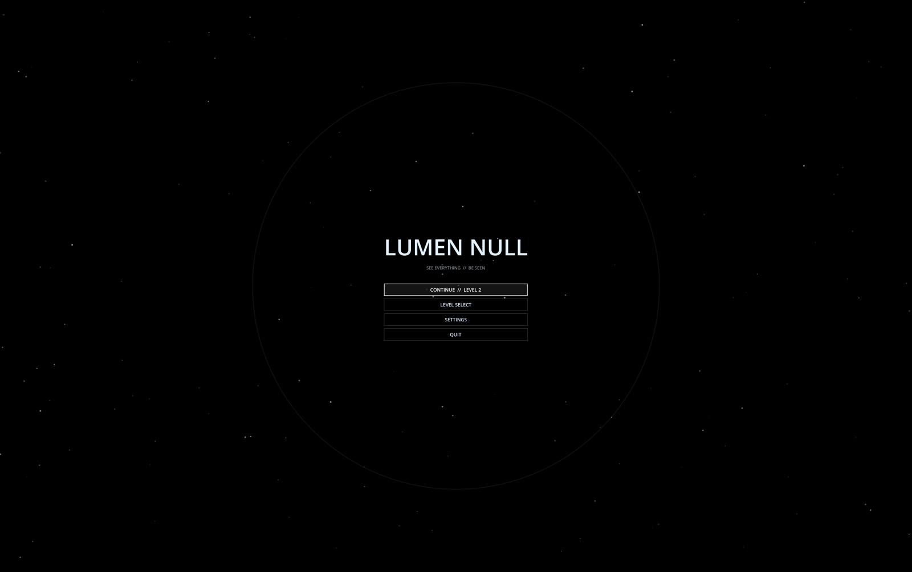
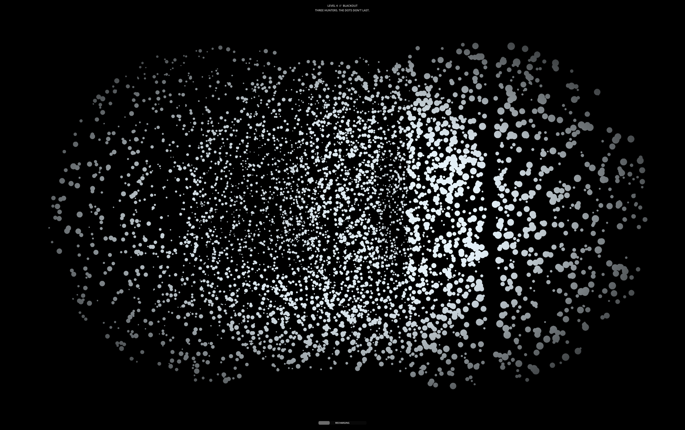

# LUMEN NULL

*See everything. Be seen.*

You wake up blind in a pitch-black facility, armed with a lidar scanner instead
of a flashlight. Every scan fires a cone of rays ahead of you and paints the
world as fading white dots. Somewhere in the dark is a hidden exit gate, and
something tall and thin is patrolling it. The hunter hears every scan you fire,
walks to where you were, and searches. Seeing is what gives you away.

Think *Scanner Sombre* meets *Alien: Isolation*, played entirely in afterimages.
Built in Godot 4.7 in GDScript. The hunter model is built in code, and the
footsteps, drone, alert sting and menu music were generated by script. There
are no imported models or textures.




## Run it

You need [Godot 4.7](https://godotengine.org/download) (the standard build, not
.NET). On macOS, `brew install --cask godot` also works.

```bash
git clone https://github.com/tundra-node/lumen-null.git
cd lumen-null
godot --path .
```

Or open the Godot project manager, import `project.godot`, and press Play
(F5). There is no build step; Godot runs the project from source. Exported
builds are published as GitHub release v0.4.8:
github.com/tundra-node/lumen-null/releases


## Checks

```bash
godot --headless --path . --quit                                # parse every script; look for SCRIPT ERROR
godot --headless --path . --script res://tests/test_levels.gd   # level data and builder checks
```

`tests/test_levels.gd` checks every map (36x36, one of each marker, exit and
waypoints reachable from the start, hunters spawn away from the player), then
builds each level and checks the hunters, walls, nav grid, and that the hunter
pathing finds a route to the exit. It exits non-zero on failure. GitHub Actions
runs both on every push (`.github/workflows/checks.yml`).

## Controls

| Key | Action |
|-----|--------|
| WASD | move |
| Shift | sprint (loud) |
| Space | jump |
| Mouse | look |
| Hold E, release | charge and fire a scan. Longer = more rays and range (12 to 24 m), longer recharge (60% to 100% of the level value) |
| Esc | skip the tutorial; otherwise pause |
| R | restart the level |
| N / M | next level / main menu (finish and pause menus) |
| V | drop noise distraction item (when carrying one) |

## Levels

| # | Name | What is harder |
|---|------|----------------|
| 1 | THE SIGNAL | Tutorial. One hunter, which ignores your practice scan. 1.4 s recharge, 7 s dots. |
| 2 | CROSSING | Zig-zag corridors, one slightly faster hunter, 1.8 s recharge, 5 s dots. |
| 3 | TWINS | A 3x3 grid of rooms, two faster hunters that notice you from farther away. 2.1 s recharge, 4.5 s dots. |
| 4 | BLACKOUT | A braided maze, three hunters, 2.4 s recharge, dots that fade in 3.5 s. |
| 5 | THE KEY | Find the key to open the door to the exit. One hunter, 2.0 s recharge, 4.5 s dots. |
| 6 | STATIC | Scan-reactive doors and lights. One hunter, 2.2 s recharge, 3 s dots. |

Recharge times are for a full charge. Clearing a level unlocks the next and saves your best time. The finish menu
offers next level, replay, level select and main menu.

## Difficulty

Choose Easy, Normal, or Hard from the title screen settings (or the difficulty selector when replaying a cleared level):

| Difficulty | Minimap | Compass | Hunters | Dots fade |
|------------|---------|---------|---------|-----------|
| Easy | yes | yes | standard speed | normal |
| Normal | no | yes | standard speed | normal |
| Hard | no | no | 25% faster | 25% faster |

## HUD

- **Minimap** (Easy only): bottom-left radar showing scanned cells and your position.
- **Compass** (Easy and Normal): top-center red needle showing your facing direction.
- **UI Scale**: settings slider from 0.75x to 2.0x; scales the entire HUD.

## How it plays

- **Scanning.** Dots are white, random sizes, and fade over a few seconds
  (faster on harder levels). Hunters show red, the exit gate shows cyan.
- **The exit** is invisible until a scan hits it. It also plays a faint,
  directional chime.
- **The hunter** patrols, and reacts to every scan: it flashes red, paths around
  walls to where you scanned from, searches, then resumes patrolling.
- **It can also find you without a scan**, in two ways:
  - *Sprinting.* It hears sprint footsteps within about 8 to 11 m (varies by
    level) and goes to where you were.
  - *Proximity.* If you are within about 3.4 to 4.5 m with a clear line of
    sight, it spots you and chases. Walls block this.
  
  Walking quietly and keeping walls between you and it avoids both. It kills on
  contact. A hunter that spots you lights itself up in red dots and plays a sting.
- **Sound is positional.** Your footsteps are much quieter than the hunter's, and
  you can hear its footsteps, heartbeat (faster when it is near) and alerts.

## Adding a level

Levels are data. Add an entry to `LEVELS` in `scripts/level_data.gd`, and bump
`COUNT`. A map is 36 rows of 36 characters, one cell = 1 m:

| Char | Meaning |
|------|---------|
| `#` | wall (floor to ceiling) |
| `.` | floor |
| `P` | player start |
| `E` | exit gate |
| `1` to `3` | hunter spawn points |
| `a` to `l` | patrol waypoints |
| `K` | key pickup |
| `D` | key door (blocks exit until key collected) |
| `L` | scan-reactive light |
| `&` | scan-reactive door |

Each entry also sets `name`, `tagline`, `scan_cooldown`, `dot_lifetime`,
`hunter_speed` (multiplier), `chase_radius`, `noise_radius`, and a `hunters`
list of `{spawn, patrol}` where `patrol` is a string of waypoint letters in
order. Keep the exit reachable and the hunters well away from the start; run
`tests/test_levels.gd` to check. The shipped levels use corridors 2 m wide or more, which is what the hunter's
pathfinding has been tested with.

## Structure

```
project.godot          - Godot project; autoloads GameState and GameSettings
scenes/
  level.tscn           - shared level shell; level_builder.gd fills it from level_data.gd
  player.tscn          - first-person controller with the lidar camera
  enemy.tscn           - the hunter (procedural model, see hunter_model.gd)
  exit_beacon.tscn     - the exit gate
  wall.tscn            - a 2x4x2 wall block, scaled by the builder
  hud.tscn             - vignette, reticle, meter, tooltips, minimap, compass (hud.gd builds the menus)
  title_screen.tscn    - the title screen (built in title_screen.gd)
  key.tscn             - key pickup
  door.tscn            - key door
  scan_light.tscn      - scan-reactive light
  scan_door.tscn       - scan-reactive door
  noise_item.tscn      - noise distraction pickup
  noise_emitter.tscn   - noise distraction emitter
scripts/
  game_state.gd        - autoload: current level, win/lose, run timer, scene changes
  game_settings.gd     - autoload: sensitivity, volume, fullscreen, difficulty, ui_scale, unlocks, best times
  level_data.gd        - the six levels: ASCII maps and difficulty
  level_builder.gd     - builds walls, hunters, start and exit from a map
  level_director.gd    - tutorial (level 1) or level intro banner
  player.gd            - movement, footsteps, charge-and-release scan, noise item drop
  scanner.gd           - cone raycast lidar, fading point-cloud MultiMesh, scanned-cell map
  enemy.gd             - hunter state machine and senses, stun state
  hunter_model.gd      - gaunt animated figure whose parts are scannable bodies
  nav_grid.gd          - A* grid built from level collision, for hunter pathing
  hud.gd, title_screen.gd, ui_theme.gd   - UI, minimap, compass, auto-updater
  exit_beacon.gd, ambience.gd, enemy_spawner.gd, win_zone.gd
  noise_item.gd, noise_emitter.gd   - noise distraction pickup and emitter
shaders/               - lidar_points (dots), vignette
materials/             - the two shader materials
sounds/                - ping, death, heartbeat, plus generated footsteps, drone, alert, menu music
tests/test_levels.gd   - headless level checks
docs/                  - README screenshots (ignored by Godot)
ROADMAP.md             - what is done and what is next
build_release.sh       - one-command build, package, and GitHub release script
```

## Settings and saves

Mouse sensitivity, volume, fullscreen, scan key, difficulty, ui_scale, unlocked levels and best times are saved
to `user://lumen_null_settings.cfg` (on macOS:
`~/Library/Application Support/Godot/app_userdata/LUMEN NULL/`). Delete that
file to reset progress.

## AI usage

Bug fixes, unit tests, and this README were written with help from an AI coding agent. The game design, all GDScript gameplay code, and every level were written by me.

## License

MIT. See [LICENSE](LICENSE).
